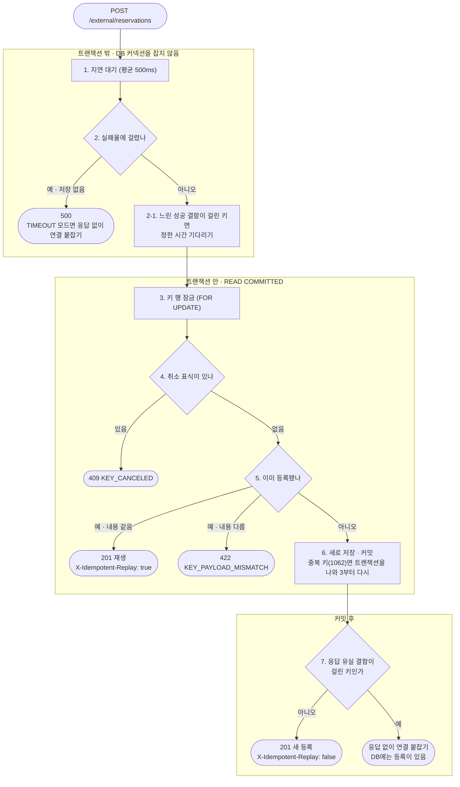
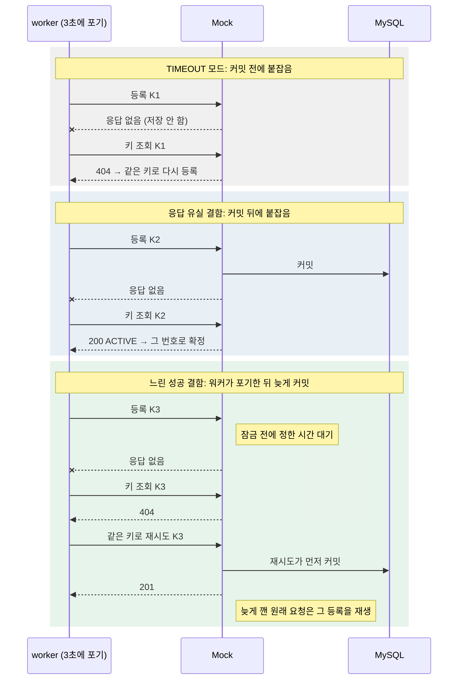
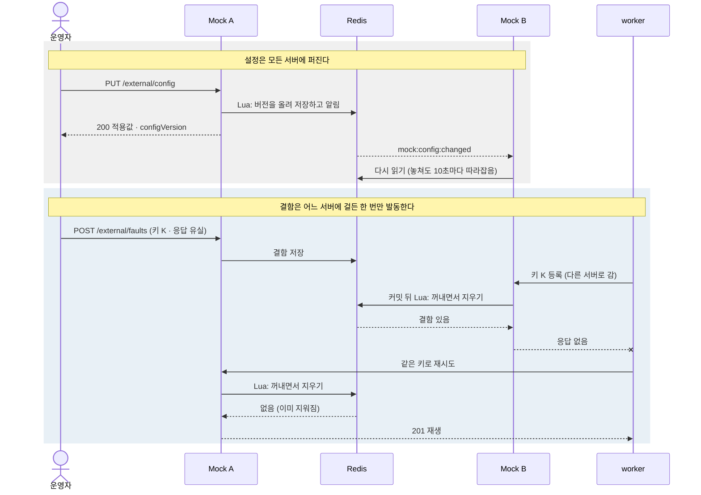
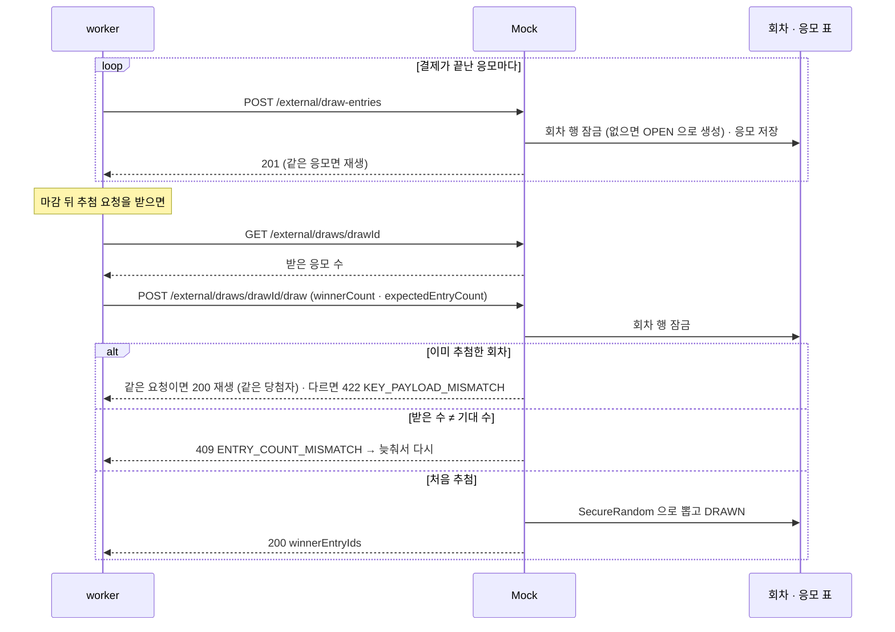
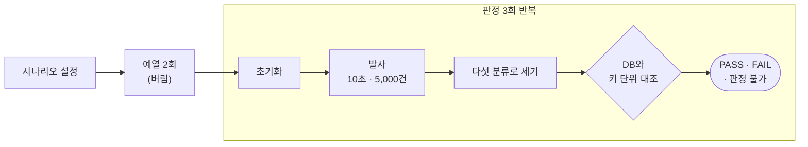

# 외부 예약 Mock

사전예약 서비스가 부르는 **외부 예약 시스템(통신사 예약 서버)을 대신하는 서버**입니다. 평균 500ms 지연과 5% 실패를 재현하고, 시연 중에도 재기동 없이 지연과 실패율을 바꿀 수 있습니다.

## 📜 목차

1. [소개](#-소개)
2. [주요 기능](#-주요-기능)
3. [아키텍처](#-아키텍처)
4. [개발 환경](#-개발-환경)
5. [설계와 기술 특이점](#-설계와-기술-특이점)
6. [부하 시험 결과](#-부하-시험-결과)
7. [API](#-api--12개)
8. [꼭 알아야 할 계약](#-꼭-알아야-할-계약)
9. [문서](#-문서)

## 🎯 소개

실제 외부 예약 시스템은 느리거나 실패하거나, 등록은 했는데 응답을 돌려주지 못하기도 합니다. 본 서비스는 이런 상황에서도 **같은 예약을 두 번 등록하지 않고, 어떤 예약도 잃어버리지 않아야** 합니다. 이것을 검증하려면 장애를 확률에만 기대지 않고 **지정한 순간에 지정한 방식으로** 만들어 주는 상대 서버가 필요해서 Mock을 만들었습니다.

## ✅ 주요 기능

| 기능 | 내용 |
| --- | --- |
| 예약 등록 · 조회 · 취소 | 멱등 키로 같은 요청을 재생하고, 키 조회로 등록 여부를 확인하고, 취소 표식으로 늦게 도착한 등록을 막습니다 |
| 지연 · 실패 주입 | 평균 지연(지터), 느린 꼬리, 실패율, 실패 모드(`HTTP_5XX` · `TIMEOUT` · `MIXED`)를 설정 API로 바꿉니다 |
| 결함 주입 | 지정한 키 하나에 **응답 유실**이나 **느린 성공**을 정확히 한 번 일으킵니다 |
| 초기화 | 시험 사이에 기록을 지웁니다. 진행 중인 요청이 있으면 거절합니다 |
| 럭키드로우 | 응모를 한 건씩 받고, 기대 응모 수를 확인한 뒤 당첨자를 뽑습니다 |
| 여러 대 실행 | 설정과 결함을 Redis로 공유해서, 한 대에서 바꿔도 모든 서버에 적용됩니다 |

## 🏛 아키텍처

- 부하 하네스(`./gradlew loadTest`)도 같은 API를 부르고, 판정할 때는 원장을 JDBC로 직접 읽습니다.
- Redis는 여러 대(`mock.shared-state=redis`)로 띄울 때만 씁니다. 운영은 평소 1대이고 부하 시험 때 오토스케일링으로 최대 5대까지 늘어나서, redis 모드로 돕니다.

| 패키지 | 맡은 일 |
| --- | --- |
| `registration` | 예약 등록 · 조회 · 취소, 멱등 판정, 예약 번호 발급 |
| `draw` | 럭키드로우 응모 · 회차 조회 · 추첨 |
| `control` | 설정 · 결함 주입 · 초기화 API, 초기화 장벽 |
| `global/chaos` | 설정 스냅샷, 지연(몸통 · 꼬리) · 실패 주입, 결함 보관과 발동 |
| `global/config` | 설정 기본값과 기동 검사, 엄격한 JSON |
| `global/persistence` · `validation` | 중복 키(1062) 재시도, 키 · 번호 형식 규칙 (여러 패키지가 같이 씀) |

패키지 안은 `api → application → domain` 한 방향으로만 의존합니다.

## 🖥 개발 환경

 

## ✨ 설계와 기술 특이점

### 1. 등록 처리 순서: 이중 등록을 막는 구조

| 결정 | 이유 |
| --- | --- |
| **대기는 트랜잭션 밖에서 합니다** | 트랜잭션 안에서 기다리면 그동안 DB 커넥션이 묶여 풀이 마릅니다(지연 2초 · 풀 20개면 10 RPS에서도 마릅니다) |
| **취소 표식을 재생보다 먼저 봅니다** | 순서가 반대면 "등록 → 취소 → 재등록"이 201로 재생됩니다 |
| **취소는 등록이 없어도 표식을 남깁니다** | 표식 뒤에 늦게 도착한 등록은 409로 막히므로, 외부에만 등록이 남는 "유령 등록"이 생기지 않습니다 |
| **쓰기는 READ COMMITTED입니다** | MySQL 기본값(REPEATABLE READ)에서는 갭 락끼리 막혀, 서로 다른 새 키의 동시 등록도 교착합니다(재현: 동시 50건 × 5회 중 85%가 500) |
| **키 조회는 `FOR SHARE`로 읽습니다** | 커밋 중인 등록을 기다려야 놓치지 않습니다. 다만 지연 중인 등록은 아직 잠금 전이라 404로 보이므로, **404는 "지금 없음"이지 "앞으로도 없음"이 아닙니다** |

### 2. 결과 불명을 세 가지로 나눠 재현

워커에게는 똑같이 "응답 없음"이지만 DB 상태가 다른 세 경우를, 확률에 기대지 않고 따로 만듭니다.

| 장치 | 일어나는 일 | DB |
| --- | --- | --- |
| 실패 모드 `TIMEOUT` | 커밋 전에 응답 없이 연결을 붙잡습니다 | 없음 |
| 결함 `RESPONSE_LOST_AFTER_COMMIT` | 커밋한 뒤 응답하지 않습니다 | 있음 |
| 결함 `SLOW_SUCCESS` | 워커가 포기한 뒤에 늦게 커밋합니다 | 나중에 생김 |

그래서 워커는 결과 불명을 받으면 새 키를 만들지 않고 키 조회부터 해야 합니다.

### 3. 기다리는 서버라서 가상 스레드

Mock이 하는 일의 대부분은 일부러 기다리는 것입니다(평균 500ms, `TIMEOUT`은 7초). 일반 스레드로는 잠자는 요청이 스레드를 다 차지해 Mock이 병목이 되고, 본 서비스 측정에 Mock의 한계가 섞입니다. 그래서 가상 스레드를 쓰고, 꺼져 있으면 기동하지 않게 했습니다.

### 4. 여러 대에서 설정 · 결함 공유 (Redis + Lua)

기본(`memory`)은 설정과 결함이 서버마다 메모리에 있어서, 여러 대면 바꾼 서버에만 적용됩니다. 여러 대로 늘어날 수 있으면(운영은 평소 1대, 최대 5대) `mock.shared-state=redis`로 Redis에 두고 나눕니다.

| 대상 | 방법 |
| --- | --- |
| 설정 | 요청은 각 서버의 메모리 값을 읽습니다. 바꾸면 Lua로 버전을 올려 저장하고 알림(`mock:config:changed`)을 보내며, 다른 서버는 다시 읽습니다. 알림을 놓쳐도 10초마다 따라잡습니다 |
| 결함 | Lua로 "꺼내면서 지우기"를 한 번에 해서, 서버가 몇 대이든 한 번만 발동합니다(서버 3대 × 30회 동시 → 1회) |
| Redis 장애 | 등록은 마지막 설정으로 계속되고, 결함은 "없음"으로 넘어갑니다. Redis가 재시작으로 설정을 잃으면 마지막 설정을 다시 올립니다 |
| 시간 초과 상한 | 등록 하나가 Redis를 두 번 보므로, Redis 시간 초과가 없거나 워커 타임아웃의 1/4을 넘으면 기동하지 않습니다. 운영값(500ms)이면 Redis가 멈춰도 약 1.1초에 넘어가고, 시험이 2초 안을 확인합니다 |

로컬 5대로 띄워 설정이 0.3초 안에 퍼지고 결함이 한 번만 발동하는 것을 확인했습니다.

### 5. 럭키드로우는 회차 행 한 줄로 줄 세우기

| 결정 | 이유 |
| --- | --- |
| **응모와 추첨이 모두 회차 행을 `FOR UPDATE`로 잠급니다** | 같은 추첨 요청은 메시지 중복 전달과 worker 재전송 때문에 정상 흐름에서도 겹쳐 옵니다. 한 줄로 서야 한 번만 뽑고 나머지에는 처음 결과를 재생합니다(잠금을 빼면 동시 10건이 모두 새로 뽑았습니다) |
| 응모는 "같은 응모 재생 → 추첨 여부(409) → 같은 회원(409)" 순서로 봅니다 | 추첨 뒤에 온 재전송을 409로 거절하면 worker가 들어간 응모를 안 들어간 것으로 믿습니다 |
| 당첨자는 `SecureRandom` 부분 Fisher–Yates로 뽑습니다 | 겹치지 않고 모든 응모가 같은 확률이며, 결과를 미리 알 수 없어야 합니다 |

### 6. 조용히 틀어지는 설정은 기동할 때 잡기

빠져도 오류 없이 다른 값으로 도는 설정은 기동 단계에서 막습니다.

- 가상 스레드가 꺼져 있으면 뜨지 않습니다.
- 응답 없이 붙잡는 유지 시간이 워커 타임아웃 + 2초보다 짧으면 뜨지 않습니다. 짧으면 워커가 타임아웃 대신 빈 500을 받기 때문입니다.
- redis 모드에서 Redis 시간 초과가 없거나 너무 길면 뜨지 않습니다.

### 7. 스키마

- **운영 DB의 표는 `db/migrations`(Flyway)가 정본이며**, release가 배포 전에 적용합니다([deploy.md](docs/deploy.md)).
- `docs/schema.sql`은 같은 표를 한 파일로 모은 것으로, 로컬 compose와 MySQL 시험이 씁니다. 표를 바꾸면 둘을 함께 고칩니다.
- 표는 세 개입니다: 등록 원장 `preorder_registrations`, 럭키드로우 `draws` · `draw_entries`.

## 📊 부하 시험 결과

본 서비스 부하 시험에서 응답이 느릴 때 원인이 본 서비스인지 Mock인지 가르려고, **Mock을 어디까지 믿을 수 있는지 먼저 재 두었습니다.** 일반 도구는 "결과 불명"을 따로 세지 못하고 DB와 대조하지도 않아서, 하네스(`./gradlew loadTest`)를 직접 만들었습니다.

| 항목 | 내용 |
| --- | --- |
| 조건 | 10초에 5,000건(500 RPS), 시나리오마다 예열 2회 → 초기화 → 판정 3회 |
| 합격 조건 | 건수가 아니라 **응답을 키마다 DB와 대조**합니다. 201을 받은 키는 같은 번호로 있어야 하고, 5xx를 받은 키는 없어야 합니다 |
| **결과 (2026-10-01)** | **15회 모두 PASS.** 계약 위반 0건, 실패율 5%가 관측에서 4.8 ~ 5.5%, Mock이 더한 시간(오버헤드) p95 약 50ms |
| **팀에 주는 선** | **커넥션 풀 30이면 Mock은 500 RPS를 오버헤드 100ms 안에 처리합니다.** 풀 20은 병목이었습니다 |

- **가장 중요한 발견**: 지연 때문에 늦은 결과 불명은 DB에 **남아 있고**, `timeout`으로 만든 결과 불명 5,000건은 DB에 **하나도 없었습니다.** 클라이언트에게는 둘 다 "응답 없음"이라, 멱등 키와 키 조회가 없으면 재시도가 중복 등록이 됩니다.
- **한계**: Mock · MySQL · 하네스를 한 PC에서 돌렸고, 판정은 당시 워커 타임아웃 5초 기준입니다(지금은 3초).

돌리는 법과 판정 규칙은 [operations.md](docs/operations.md) 3장에 있습니다.

## 📮 API · 12개

| 메서드 | 경로 | 설명 |
| --- | --- | --- |
| POST | `/external/reservations` | 예약 등록 (멱등) |
| GET | `/external/reservations` | 원장 목록 조회 (정합성 검사용, 외부 키 커서 페이지) |
| GET | `/external/reservations/{externalNumber}` | 번호로 단건 조회 |
| GET | `/external/reservations/by-key/{externalKey}` | 키로 등록 상태 조회 |
| POST | `/external/cancellations` | 예약 취소 |
| POST | `/external/draw-entries` | 럭키드로우 응모 (멱등: 응모 id) |
| GET | `/external/draws/{drawId}` | 럭키드로우 회차 조회 (받은 응모 수 · 추첨 결과) |
| POST | `/external/draws/{drawId}/draw` | 럭키드로우 추첨 (멱등: 회차 id) |
| GET · PUT | `/external/config` | 지연 · 실패 설정 조회와 변경 |
| POST | `/external/faults` | 결함 주입 (응답 유실 · 느린 성공) |
| POST | `/external/reset` | 기록 초기화 |

## 📌 꼭 알아야 할 계약

- 워커는 HTTP 상태가 아니라 `errorCode`로 분기합니다. **5xx와 타임아웃은 미등록의 증거가 아니므로**, 다시 보내기 전에 키 조회로 확인합니다. 키 조회의 404는 "지금 등록이 없다"는 뜻이라 같은 키로 다시 보냅니다. 같은 키로 취소하는 것은 예약을 취소로 끝낼 때뿐입니다.
- 멱등 키는 본 서비스의 `preorder_token`입니다. 대소문자를 구별하고, 영문 · 숫자 · `. _ -`로 된 1 ~ 100자입니다.
- 요청 본문에 계약에 없는 필드가 있으면 400입니다.
- 지연과 실패는 등록과 럭키드로우 응모 · 추첨에만 넣습니다. 조회 · 취소 · 설정에는 넣지 않으므로, 실패율을 100%로 올려도 설정을 되돌릴 수 있습니다.
- 정합성 검사는 `external_mock` 스키마를 직접 조회하지 않고, 원장 목록 조회 API로 읽습니다.

## 📁 문서

| 문서 | 내용 |
| --- | --- |
| [docs/api.md](docs/api.md) | **API 명세 정본**: 요청 · 응답 · 오류 계약 · 확인 시나리오 |
| [docs/operations.md](docs/operations.md) | **로컬 실행 · 시험 규칙**(0장), Mock 조절 · 장애 재현 · 부하 실행과 판정 · 결과 확인 · 시연 대본 |
| [docs/deploy.md](docs/deploy.md) | 빌드 · 배포: 워크플로 · 이미지 · 스키마 변경 |
| [db/migrations](db/migrations) | **스키마 정본**: 운영 DB의 표(Flyway, 배포 때 적용) |
| [docs/schema.sql](docs/schema.sql) | 같은 표를 한 파일로 모은 것: 로컬 compose · MySQL 시험용. 표를 바꾸면 마이그레이션과 함께 고칩니다 |

api · operations · deploy를 장마다 나눠 읽기 편하게 옮긴 사본은 [위키](https://github.com/Grandis-2/mock/wiki)에 있습니다. 내용을 바꿀 때는 위 저장소 파일을 고칩니다.
